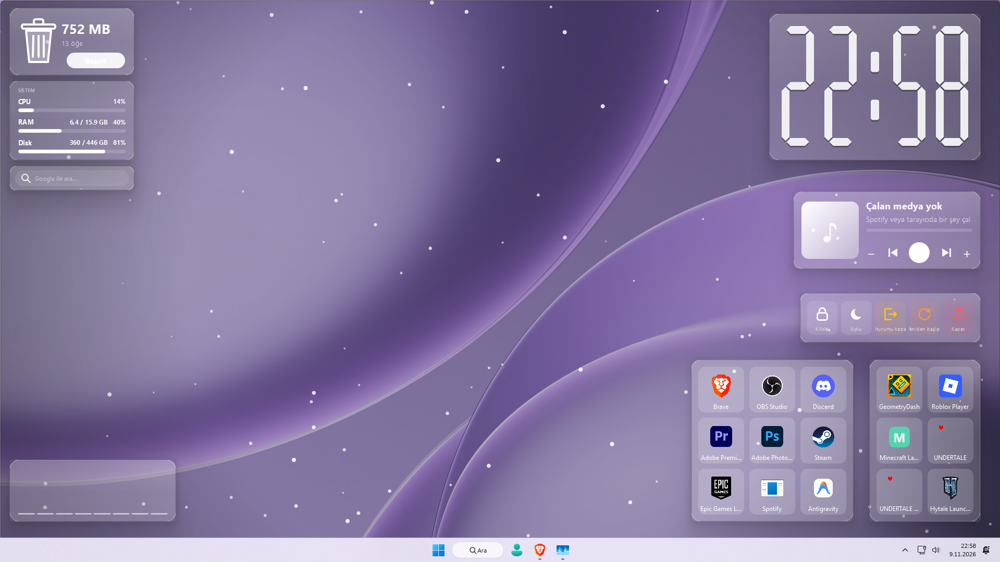

# Widget Studio

🇹🇷 Türkçe | [🇬🇧 English](README.en.md)



Rainmeter tarzı, masaüstüne serbestçe yerleştirilebilen çoklu widget sistemi. PyQt6 ile yazılmıştır.

## Özellikler

### Widget türleri
- **Saat**: Büyük, şeffaf saat. Her rakam ayrı ayarlanabilir.
- **Analog saat**: Saniye ve rakam gösterimi seçenekli.
- **Uygulama çubuğu**: 9 slotlu (3x3) başlatıcı. Her yeni çubuk 9 slot ekler. Slotlara tıklayarak programları başlatabilir, dosya ya da uygulama sürükleyip bırakabilirsin.
- **Takvim**, **Tarih kartı**, **Geri sayım**
- **Sistem monitörü** (CPU / RAM / Disk)
- **Ağ hızı** (grafik)
- **Pil durumu**
- **Not defteri**, **Yapılacaklar**
- **Zamanlayıcı** (Pomodoro), **Kronometre**
- **Medya oynatıcı**: Önceki / oynat / sonraki, ses ayarı, kapak görseli, ilerleme çubuğu
- **Ses görselleştirici**
- **Hızlı arama**
- **Pano geçmişi** (yalnızca bellekte tutulur)
- **Çöp kutusu**
- **Kırpma aracı**: Ekranda alan seçerek kırpma yapar
- **Sistem düğmeleri**: Kilitle, uyku, oturum kapat, yeniden başlat, kapat (onaylı)
- **Duvar kağıdı efektleri**: Kar, yağmur, yıldız, ateşböceği, matrix, sakura, kutup ışığı; ayrıca renk filtresi, vinyet ve gün döngüsü

### Genel özellikler
- **Ortak tema**: Tüm widget'lar aynı renk, cam efekti, köşe ve kenarlık ayarlarını paylaşır. Hazır temalar vardır ve değişiklik anında uygulanır.
- **Yapışma**: Widget'lar birbirine ve ekran kenarlarına yapışır.
- **Şeffaflık**: %10 ile %100 arasında ayarlanabilir. "Üstüne gelince soluklaştır" seçeneği vardır.
- **Tepsi menüsü**: Widget ekleme, tümünü gizle/göster, ayarlar ve çıkış.
- **Otomatik yenileme**: Ayar dosyası elle düzenlenirse widget'lar kendini günceller.

## Gereksinimler

- Python 3.9 veya üzeri
- PyQt6

Tam deneyim için isteğe bağlı paketler:

```bash
pip install winsdk                 # Medya oynatıcıda kapak ve tam bilgi (Windows)
pip install numpy pyaudiowpatch    # Ses görselleştirici (Windows)
```

`winsdk` kurulu değilse medya oynatıcı Spotify ve YouTube başlığını pencere adından okur.

## Kurulum

```bash
git clone https://github.com/Salih5834/WidgetStudio.git
cd WidgetStudio
pip install PyQt6
```

## Kullanım

```bash
python WidgetStudio.py
```

Konsol penceresi görünmesin istiyorsan dosyanın uzantısını `.pyw` yapabilirsin.

### Temel işlemler
- **Widget ekleme**: Tepsi simgesine (ya da bir widget'a) sağ tık → **Widget ekle** → türü seç.
- **Taşıma**: Widget'ı sürükle. Ekran kenarına yapışır.
- **Ayarlar**: Widget'a sağ tık → **Ayarlar…** (Saatte çift tık da ayarları açar.)
- **Uygulama çubuğuna program ekleme**: Boş (+) slota tıkla. Başlat menüsündeki programlar ve Store uygulamaları listelenir. Birden fazla seçersen boş slotlara sırayla yerleşir.
- **Slot değiştirme / temizleme**: Slota sağ tık → **Değiştir** veya **Temizle**.
- **Duvar kağıdı efekti**: Tepsi → **Widget'lar** → **Duvar kağıdı efekti** → **Ayarlar**.

## Yapılandırma dosyası

Tüm ayarlar kullanıcı klasöründeki `~/.widget_studio.json` dosyasında saklanır. Dosyayı elle düzenlersen değişiklikler birkaç saniye içinde uygulanır.

## Platform desteği

Uygulama Windows için tasarlanmıştır. Başlat menüsü taraması, Windows ile başlatma, medya ve ses özellikleri Windows'a bağlıdır. Diğer platformlarda bazı özellikler çalışmayabilir.

## Lisans

Bu proje [MIT](LICENSE) lisansı altında dağıtılmaktadır.
